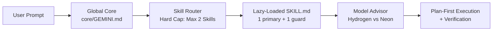

# Zero Slop Antigravity

**Stop burning your 5-hour Antigravity quota in 45 minutes — and stop shipping AI code slop.**

[](LICENSE)
[](https://antigravity.google)
[](skills/)
[](core/GEMINI.md)

A token-efficient Global Core, strict anti-slop rules, a Secret Guard, and 15 lazy-loaded skills with a **max-2 skill router** — for Google Antigravity / Gemini CLI agents.

By **nathanealphi**.

---

## The problem

Default agent behaviour is expensive in exactly the wrong places:

- It scans the whole repo from the root, including `node_modules/`, build output, lockfiles, SQL dumps, and media.
- It loads every rule and every skill at once, then re-reads files it already saw.
- It rewrites whole files for a one-function fix, dumps raw logs into chat, and echoes long code back at you.
- It invents code it never read, leaves `// TODO` placeholders, and adds neon-purple gradients nobody asked for.

The result is familiar: quota gone before lunch, a long diff full of noise, and a review that finds the real bug on the third pass.

## Before / after

| | Before (default agent) | After (Zero Slop) |
| :--- | :--- | :--- |
| **Repo scan** | Blind `grep` / `ls -R` from root, including dependencies and dumps | Targeted reads only; dependencies, build output, lockfiles, dumps, and media ignored |
| **Context loaded** | All rules, all skills, all the time | Global Core only; at most **2 skills per task**, lazy-loaded |
| **Edits** | Whole-file rewrites for a small fix | Diff-first, surgical edits to the relevant block only |
| **Terminal output** | Full raw logs pasted into chat | Filtered (`tail -n 40` / `grep error\|fail`) |
| **Chat echo** | Long code blocks repeated after every edit | `file:line` + 2–3 sentences |
| **Secrets** | `.env` and credential files readable by accident | Secret Guard: `.env`, `*.pem`, `*.key` never read, never printed |
| **New code** | Generic AI style, placeholders, over-engineering | Strict mimicry of the repo, zero placeholders, Rule of Three |
| **Session end** | Context lost on `/clear` | `session-handoff` writes a 25-line `HANDOFF.md`; resume with `@HANDOFF.md continue` |

> **Benchmark note — [personal benchmark, edit to your numbers]:** the gains above are architectural (fewer files read, fewer skills loaded, smaller diffs), not a measured lab benchmark. On my own projects, the visible effect was a session that used to exhaust a 5-hour quota window in under an hour now lasting a full work session, because blind scans and full-log dumps were removed. Measure it on your own repo and replace this paragraph with your numbers.

---

## How it works



1. **Global Core** (`core/GEMINI.md`) sets the non-negotiable rules: no blind scans, no hallucination, Secret Guard, filtered output, no code echo.
2. **Skill Router** picks at most **1 primary + 1 guard skill** from the trigger table. Loading 3+ skills is forbidden.
3. **Lazy-loaded skills** are read only when their trigger fires — never all at once.
4. **Model Advisor** routes the work: Hydrogen for clear plans, UI edits, light bugs, and tests; Neon (thinking `medium` / `low`) only for new architecture, complex cross-repo work, or hard debugging.
5. **Plan-first execution** writes a 5–7 point plan, waits for one approval, then runs to completion — with an emergency brake after the same error twice.

---

## Quick start

### Option A — 1-line install (recommended)

```bash
curl -fsSL https://raw.githubusercontent.com/contact-nathanealphi/zero-slop-antigravity/main/install.sh | bash
```

What it does: installs the Global Core to `~/.gemini/GEMINI.md` and the 15 skills to `~/.agent/skills/`. It is idempotent — already-installed files are skipped, and an existing `GEMINI.md` is backed up to `~/.gemini/GEMINI.md.bak.<timestamp>` before replacement.

```bash
# Reinstall / overwrite everything
curl -fsSL https://raw.githubusercontent.com/contact-nathanealphi/zero-slop-antigravity/main/install.sh | bash -s -- --force

# Also drop a .antigravityignore into the current project
curl -fsSL https://raw.githubusercontent.com/contact-nathanealphi/zero-slop-antigravity/main/install.sh | bash -s -- --init-local
```

### Option B — Copy-paste, no script

1. Open [`MASTER_PROMPT.md`](MASTER_PROMPT.md).
2. Copy the whole prompt into Antigravity.
3. The agent installs the Global Core, the 15 skills, and a local `.antigravityignore` + project `GEMINI.md` in one batch. If everything is already installed, it skips to the local setup only. Add `force update` to reinstall.

---

## The 15 modular skills

| Skill | Category | Trigger | What it does |
| :--- | :--- | :--- | :--- |
| `ultra-quota-guard` | Quota | Large task (> 5 files) / massive refactor | Diff-first, surgical edits, budget check, split into 2 sessions if needed |
| `session-handoff` | Memory | `checkpoint` / before `/clear` | Writes a 25-line `HANDOFF.md` so the next session resumes cleanly |
| `lesson-learner` | Memory | User corrects a pattern or technical choice | Records 1–2 permanent lines in `LESSONS.md` |
| `rekap-auto-updater` | Memory | Large feature or QA stage done | Appends a 3–5 line progress update, never rewrites the file |
| `blast-radius-analyzer` | Safety | Editing a shared function / core / global state | Maps every caller before the edit |
| `version-lock-guard` | Correctness | New feature using a third-party library | Verifies APIs against the exact installed version |
| `git-safety-net` | Safety | Plan changes >= 2 files | Backup commit before, clean commit after, rollback hash reported |
| `db-schema-guard` | Safety | Migration / table / query / ORM | Blocks SQL dumps and destructive commands without confirmation |
| `anti-slop-strict` | Quality | Writing a feature / module / page from scratch | 7 pillars: mimicry, no obvious comments, Rule of Three, no defensive slop, zero placeholders, anti-slop UI, minimal diff |
| `api-contract-sync` | Correctness | Endpoint / payload / API model change | Syncs the contract on both sides with a targeted grep |
| `edge-state-checklist` | UI | Creating / reworking a page or component | Loading, Empty, Error, and Overflow handled explicitly |
| `design-token-enforcer` | UI | Styling a component / page | Forces project tokens / theme, no hardcoded hex or random sizes |
| `surgical-debugger` | Debugging | Bug / crash / build error | One hypothesis from the top project stack frame, ~30 lines of context |
| `qa-triage-runner` | QA | Running automated tests / QA | Filtered output, 3-point summary: Pass/Fail, location, root cause |
| `adversarial-reviewer` | Review | Final review on critical logic | Strict `git diff` audit: null edges, races, N+1, leaks, validation gaps |

---

## Daily workflow cheat sheet

- **Start a task:** describe it. The agent writes `Active skills: [...]` + a 5–7 point plan, then waits for one approval.
- **Approve and run:** reply `gas`, `ok`, or `go`. The agent finishes the whole plan without asking again.
- **Checkpoint:** type `checkpoint` — the agent writes `HANDOFF.md`, then you can safely run `/clear`. Resume later with `@HANDOFF.md continue`.
- **Long chat:** run `/compact` after 10 turns, or `session-handoff` + `/clear` when a feature is done.
- **Model routing:** Hydrogen for clear plans, UI edits, light bugs, and tests. Neon (`medium` / `low`) only for new architecture, complex cross-repo integration, or hard debugging. Argon (low thinking) is a budget fallback when Neon credit is tight — same rules, smaller thinking budget.
- **Manual routing:** if the router picks wrong, name the skill in your message, for example: `use anti-slop-strict for this page`.

---

## Project layout

```text
zero-slop-antigravity/
├── README.md
├── LICENSE
├── .gitignore
├── install.sh
├── MASTER_PROMPT.md
├── core/
│   └── GEMINI.md
├── templates/
│   └── .antigravityignore
└── skills/
    ├── ultra-quota-guard/SKILL.md
    ├── session-handoff/SKILL.md
    ├── lesson-learner/SKILL.md
    ├── rekap-auto-updater/SKILL.md
    ├── blast-radius-analyzer/SKILL.md
    ├── version-lock-guard/SKILL.md
    ├── git-safety-net/SKILL.md
    ├── db-schema-guard/SKILL.md
    ├── anti-slop-strict/SKILL.md
    ├── api-contract-sync/SKILL.md
    ├── edge-state-checklist/SKILL.md
    ├── design-token-enforcer/SKILL.md
    ├── surgical-debugger/SKILL.md
    ├── qa-triage-runner/SKILL.md
    └── adversarial-reviewer/SKILL.md
```

---

## Contributing

Issues and pull requests are welcome. Keep contributions in the spirit of the project: small, surgical, and in plain technical English. If you change a skill, keep its YAML frontmatter (`name` and `description`) valid and its trigger table entry in `core/GEMINI.md` in sync.

## License

MIT — see [LICENSE](LICENSE).
