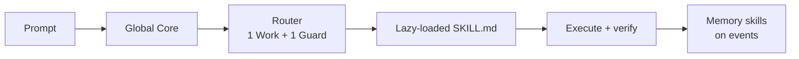

# Zero Slop Antigravity

**Stop burning your Antigravity quota on blind scans, full-log dumps, and AI code slop.**

[](LICENSE)
[](https://antigravity.google)
[](.github/workflows/validate.yml)

A token-efficient **Global Core**, a **Secret Guard**, strict anti-slop rules, and **15 lazy-loaded skills** behind a router that loads at most **1 Work + 1 Guard skill** per phase. By **nathanealphi** · v3.0.1 · [Changelog](CHANGELOG.md)

---

## The problem

Default agent behavior is expensive in the wrong places: it scans from the repo root (dependencies, build output, dumps), loads every rule at once, rewrites whole files for one-line fixes, pastes raw logs, and invents code it never read.

## Before / after

| | Default agent | Zero Slop |
| :--- | :--- | :--- |
| **Search** | `grep` / `ls -R` from root | `git ls-files` / `rg` on a target folder only |
| **Context** | All rules, all the time | Core only + max 1 Work + 1 Guard skill, lazy-loaded |
| **Edits** | Whole-file rewrites | Diff-first, surgical edits |
| **Terminal** | Raw logs in chat | Filtered / capped output |
| **Chat** | Code echoed after every edit | `file:line` + 2–3 sentences |
| **Secrets** | `.env` readable by accident | Secret Guard (see limits below) |
| **Small tasks** | Always a long plan | Direct fix (1 file or trivial 2-file edit); plan for larger work |
| **Destructive ops** | Runs after one approval | Always confirmed separately |
| **Session end** | Context lost on `/clear` | `checkpoint` → 25-line `HANDOFF.md` |

### Expected impact (architectural estimates)

| Scenario | Est. token / quota savings | Primary drivers |
| :--- | :---: | :--- |
| **Small task (1 file, 1–2 turns)** | **~10% – 25%** | Direct execution (no long plan) + no code echo |
| **Feature / refactor in large repos** | **~35% – 60%** | Targeted search (`git ls-files`/`rg`), ignore list, partial reads, max-2 lazy skills |
| **Debugging, build errors & QA tests** | **~40% – 65%** | Capped terminal output (`tail`/`grep`), ~30-line stack-frame reads, 3-point QA summary |
| **Long sessions (> 10 turns / multi-feature)** | **~50% – 70%+** | `/compact` + 25-line `HANDOFF.md` + `/clear` + routing simple work to lighter models |

> **These are architectural estimates, not measured benchmarks.** Real-world daily savings typically fall around **30% – 50%** depending on repo size, model routing, and `/clear` discipline. Measure on your own repo (note quota used for the same task with and without Zero Slop) — PRs with real numbers are welcome.

## How it works



1. **Global Core** (`core/GEMINI.md`): hard rules, workflow, router.
2. **Router** picks by type: **Work** (do the job), **Guard** (protect it), **Memory** (event-driven, tiny, not counted). If several Guards apply: `db-schema-guard` > `blast-radius-analyzer` > `version-lock-guard` > `git-safety-net`. The final review swaps in `adversarial-reviewer`.
3. **Small task** (1 file or trivial mechanical edit across 2 files): done directly. **Larger task**: `Active skills: [...]` + 5–7 point plan, one approval (`gas` / `ok` / `go` / `lanjut`), then run to the end (cross-layer tasks split into sequential phases).
4. **Always confirmed** even after approval: `rm -rf`, any `git push`, `reset --hard`, `git clean`, `DROP` / `TRUNCATE`, `DELETE` / `UPDATE` without `WHERE`, deploys, unplanned installs.

## Install

```bash
# Latest
curl -fsSL https://raw.githubusercontent.com/contact-nathanealphi/zero-slop-antigravity/main/install.sh | bash

# Pinned to a release (recommended for teams)
curl -fsSL https://raw.githubusercontent.com/contact-nathanealphi/zero-slop-antigravity/v3.0.1/install.sh | ZS_REF=v3.0.1 bash
```

Flags (append with `bash -s -- <flag>`): `--dry-run` · `--force` · `--init-local` · `--uninstall` · `--no-verify`.

- Core is added to `~/.gemini/GEMINI.md` inside `<!-- zero-slop:begin -->` … `<!-- zero-slop:end -->`. **Your own content is preserved**; the file is backed up first.
- Skills go to `~/.agent/skills/` (override: `ZS_SKILLS_DIR`). Modified skills are kept unless `--force` (then backed up).
- Everything is downloaded and checked against `SHA256SUMS` *before* anything is written. The checksum guards against corrupted downloads; for supply-chain safety, pin a tag and read the script first.
- `--init-local` writes `.antigravityignore` and `.geminiignore` into the current project.
- **Windows:** use WSL or Git Bash for the installer. The Core lists PowerShell equivalents for filtered output.

**No script?** Paste [`MASTER_PROMPT.md`](MASTER_PROMPT.md) into Antigravity (generated from these files; installs the same thing).

### Verify on your setup

Paths and names depend on your Antigravity version. Check once: that global skills load from `~/.agent/skills/` (else set `ZS_SKILLS_DIR`), that `.antigravityignore` / `.geminiignore` is honored, and that the model names in Core §4 exist.

## What Secret Guard is — and is not

It is a **prompt-level rule plus an ignore list**: it steers the agent away from `.env*`, keys, and credentials and tells it to redact them. It is **not** OS-level protection or a sandbox. Keep real secrets out of repos, add `.env*` to `.gitignore`, and use your tool's permission settings for hard enforcement.

## The 15 skills

| Type | Skill | Trigger |
| :--- | :--- | :--- |
| Work | `ultra-quota-guard` | > 5 files / massive refactor: diff-first, surgical edits, session split |
| Work | `anti-slop-strict` | New feature / module / page: 7 pillars (mimicry, no what-comments, Rule of Three, no defensive slop, zero placeholders, anti-slop UI, minimal diff) |
| Work | `surgical-debugger` | Bug / crash / build error: top project frame, ~30 lines, one hypothesis |
| Work | `edge-state-checklist` | Page / component: Loading, Empty, Error, Overflow |
| Work | `design-token-enforcer` | Styling: project tokens only, no hardcoded values |
| Work | `api-contract-sync` | Endpoint / payload change: sync both sides |
| Work | `qa-triage-runner` | Tests / QA: capped output, 3-point summary |
| Guard | `db-schema-guard` | Migration / query / ORM: no dumps, confirm destructive SQL |
| Guard | `blast-radius-analyzer` | Shared function / core change: map callers first |
| Guard | `version-lock-guard` | Third-party library: verify against the installed version |
| Guard | `git-safety-net` | 2+ file plan: local rollback point, hashes, never pushes |
| Guard | `adversarial-reviewer` | Final review: audit this task's diff |
| Memory | `session-handoff` | `checkpoint` / before `/clear`: 25-line `HANDOFF.md` |
| Memory | `lesson-learner` | User correction: 1–2 lines in `LESSONS.md` (max 40 lines) |
| Memory | `rekap-auto-updater` | Feature verified: 3–5 lines appended to `PROGRESS.md` |

Each skill's `description` carries its trigger so Antigravity can discover it. Force one manually: `use anti-slop-strict for this page`.

## Daily workflow

- **Start:** describe the task. Small → done. Larger → plan → reply `gas`.
- **Checkpoint:** type `checkpoint`, then `/clear`; resume with `@HANDOFF.md continue`.
- **Long chat:** `/compact` after ~10 turns.
- **Model routing:** cheap model for clear plans, UI edits, light bugs, tests; strong model for new architecture and hard debugging.

## Uninstall

```bash
curl -fsSL https://raw.githubusercontent.com/contact-nathanealphi/zero-slop-antigravity/main/install.sh | bash -s -- --uninstall
```

Removes the Core block (your other content stays) and the 15 skills; `.bak.*` backups are kept.

## Layout

```text
├── core/GEMINI.md            # Global Core + router
├── skills/<name>/SKILL.md    # 15 skills
├── templates/.antigravityignore
├── install.sh                # installer
├── MASTER_PROMPT.md          # generated, no-script install
├── SHA256SUMS                # generated
├── VERSION  CHANGELOG.md
└── scripts/                  # build-master-prompt, gen-checksums, validate, dev
```

## Contributing

Edit `core/` or `skills/`, then run `bash scripts/dev.sh`: it regenerates `MASTER_PROMPT.md` and `SHA256SUMS` and validates frontmatter (name, one-line description with trigger, ≤ 1500 bytes), router ↔ folders ↔ installer ↔ README consistency, and shell syntax. CI runs the same checks. Keep contributions small, surgical, and in plain technical English.

## License

MIT — see [LICENSE](LICENSE).
